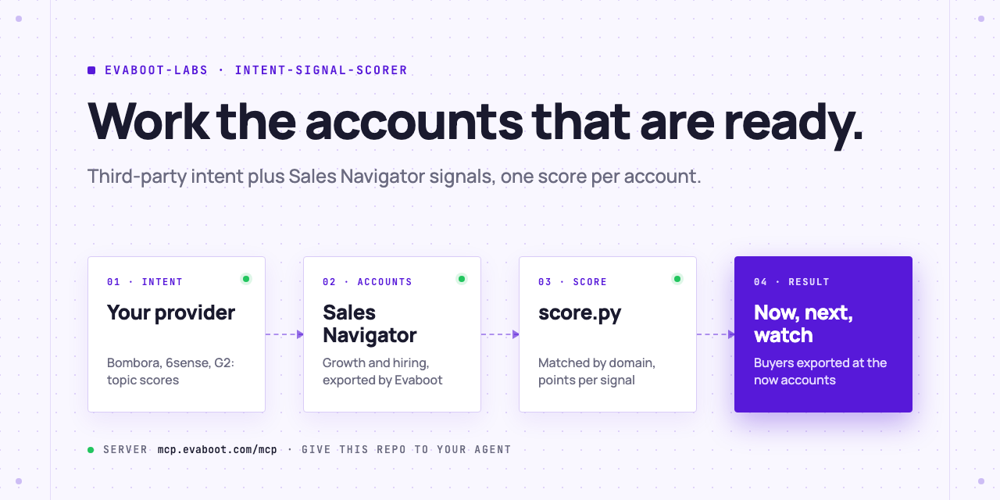

<picture>
  <source media="(prefers-color-scheme: dark)" srcset=".github/assets/banner-dark.png">
  
</picture>

# Intent signal scorer

Your intent data provider tells you which companies research your topic. Sales Navigator tells you which of them are growing and hiring. Your AI agent merges both, scores every account, and exports the buyers at the accounts worth working this week. You do the outreach.

[](AGENTS.md)
[](https://evaboot.com/mcp)
[](LICENSE)

## Set it up in one prompt

Paste this into Claude Code, Codex or Cursor:

```text
Clone https://github.com/evaboot-labs/intent-signal-scorer, read AGENTS.md and follow the skill. Score my intent export against my Sales Navigator accounts.
```

<details>
<summary>Or install the skill</summary>

Claude Code:

```text
/plugin marketplace add evaboot-labs/intent-signal-scorer
/plugin install intent-signal-scorer@evaboot-labs-intent-signal-scorer
```

Codex, Cursor and other agents:

```bash
npx skills add evaboot-labs/intent-signal-scorer
```

</details>

## How it works

**1. Your intent export.** Download the CSV from your provider (Bombora, 6sense, ZoomInfo, G2, Demandbase, Apollo): one row per company and topic, with a score. `score.py` finds the domain, topic and score columns by name.

**2. Your Sales Navigator accounts.** Your agent builds your account search with Evaboot (industry, size, region, headcount growth, hiring on LinkedIn) and exports it: domain, headcount growth over 6 months and a year, team sizes.

**3. One score per account.** Both files are matched by domain. An intent surge is worth 10 points, each more surging topic 3, a fit 5, hiring 3, fast growth 6 and 4. The points are a table in [`SIGNALS.md`](SIGNALS.md): tune them on your won and lost deals.

**4. Three tiers, then the buyers.** 20 points or more: `now`, and your agent exports the sales leaders at those accounts with verified emails. 10 to 19: `next`. Under 10: `watch`. An account with intent but outside your search is flagged "check fit".

```text
$ python3 score.py --accounts hiring=data/accounts.json --intent data/intent.csv --csv lists/today.csv > lists/today.md
```

Three rows of a test run (15 UK software accounts from Sales Navigator, a sample intent file), with the companies left out:

| Tier | Score | Signals |
|---|---|---|
| now | 31 | intent surge on 2 topics, fits your account search, hiring, headcount +234% in a year, +113% in 6 months |
| next | 18 | fits your account search, hiring, headcount +58% in a year, +21% in 6 months (no intent) |
| watch | 8 | fits your account search, hiring (no intent, slow growth) |

## What you need

- An [Evaboot account](https://dash.evaboot.com/accounts/signup/?last_click_origin=intent-signal-scorer-repo) and a Sales Navigator seat.
- An intent export from your provider as CSV. No provider yet? The scorer still ranks your accounts on Sales Navigator signals alone.
- An AI agent that can use an MCP server: Claude Code, Codex, Cursor, or the n8n version.
- Python 3.9+, with no packages to install.
- Cost: 1 Evaboot credit per exported account or lead, verified email included.

## Go further

| Page | For |
|---|---|
| [docs/connect-your-agent.md](docs/connect-your-agent.md) | The setup by hand, for each agent |
| [docs/n8n.md](docs/n8n.md) | The same ranking in n8n, every Monday, into a Google Sheet |
| [SIGNALS.md](SIGNALS.md) | Your account search, intent topics, points and tiers |

---

Agents: start at [AGENTS.md](AGENTS.md) · Built by [Evaboot](https://evaboot.com) · More workflows at [github.com/evaboot-labs](https://github.com/evaboot-labs) · [MIT license](LICENSE)
